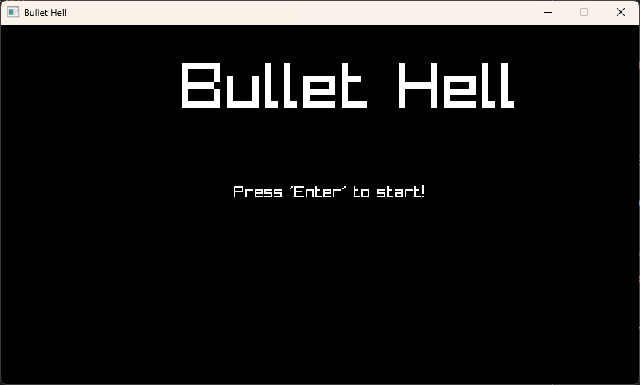
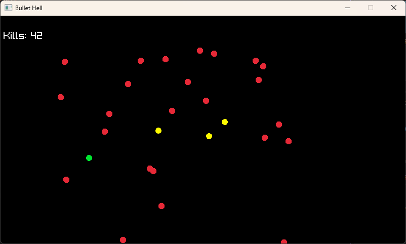
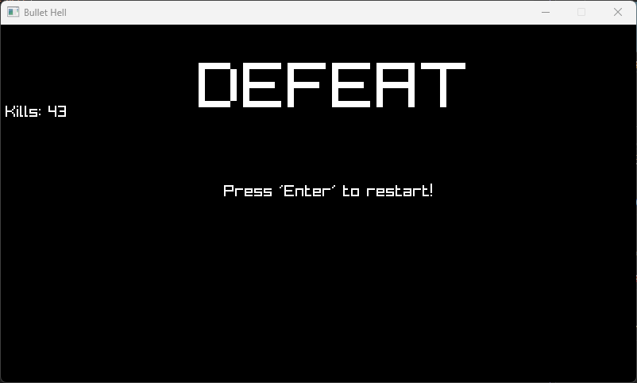

# C Bullet Hell

A small 2D bullet-hell game built in **C** using **raylib**.

## About

This is my first C game-development project. I built the initial version by following a tutorial to learn the fundamentals of game programming: the game loop, player controls, vector-based movement, collision detection, enemy spawning, fixed-size arrays, and game states.

After completing the tutorial, I revisited the source code to diagnose bugs, improve the collision logic, and balance the progression system. This remains a **tutorial-guided learning project**, not a game designed entirely from scratch.

## Gameplay

- Move the player around the arena while enemies spawn and chase you.
- Aim with the mouse and shoot projectiles to defeat enemies.
- Earn upgrades as your kill count increases.
- Survive as long as possible; restart after defeat.

### Controls

| Action | Control |
| --- | --- |
| Move | `W`, `A`, `S`, `D` |
| Aim | Mouse |
| Shoot | Hold left mouse button |
| Start / restart | `Enter` |

## Fixes and improvements after the tutorial

- **Projectile piercing:** New projectiles now inherit the current piercing upgrade, allowing them to hit additional enemies.
- **Enemy visibility:** Enemy radius has a minimum size, preventing enemies from shrinking to zero or below over time.
- **Consistent collisions and drawing:** Enemies are drawn using their own stored radius, matching collision checks.
- **Safer array removal:** Projectile and enemy loops handle swap-with-last removal without accidentally skipping replacement elements.
- **Progression balancing:** Limits on projectile speed and size, piercing, firing delay, and player radius prevent unbounded upgrades from breaking gameplay.
- **Kill counter:** Replaced unsafe string formatting with a writable buffer and bounded formatting, and adjusted text placement so the count stays visible.

These changes were tested locally in Visual Studio, including gameplay, enemy visibility over longer sessions, and the game-over/restart flow. This is an introductory project and may still have limitations.

## Technologies

- **C** — game logic and data structures
- **raylib / raymath** — graphics, input, timing, and vector operations
- **CMake** — build configuration
- **Visual Studio** — development and debugging on Windows

## Build and run

1. Install a C compiler, CMake, and any raylib dependencies required by this project's `CMakeLists.txt`.
2. Open the repository folder in Visual Studio (CMake folder support).
3. Let Visual Studio configure the CMake project, then select and run the game's executable target.

The exact dependency setup depends on the raylib configuration in `CMakeLists.txt`. The project has been tested locally on Windows; other platforms have not been verified.

## Screenshots

## What I learned

This project helped me practise reading and debugging C code, reasoning about mutable arrays and collision checks, using vectors and frame time, and testing gameplay changes rather than assuming they work. It is one step in my ongoing transition towards game programming.

## Tutorial attribution

[Full Game in C/C++ - Start Gamedev TODAY](https://www.youtube.com/watch?v=2B-pxN7W5Pw)

The first version followed that tutorial; the debugging and balancing work described above was carried out afterwards.